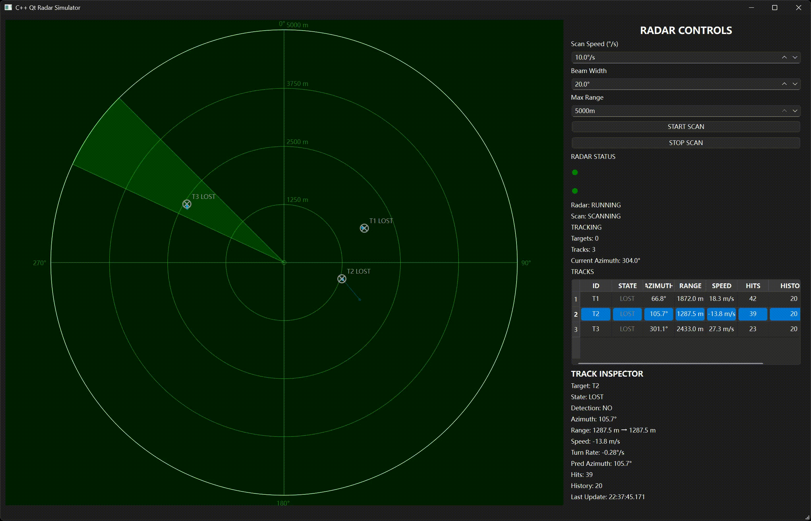

# RadarSimulator

基于 **C++17、Qt 6 Widgets、Qt Network 和 CMake** 的桌面雷达模拟器，用于学习、研究和工程演示。项目模拟目标运动、扫描与航迹显示，范围限于软件仿真和可视化。

A C++17 desktop radar simulator built with Qt 6 Widgets, Qt Network, and CMake for learning, research, and engineering demos. Its scope is software simulation and visualization.

**当前公开版本 / Current release · v0.3.0 Preview**

| 平台 | 发布说明与校验文件 | Windows x64 绿色版 |
| --- | --- | --- |
| GitHub | [Release](https://github.com/cyclone367/RadarSimulator/releases/tag/v0.3.0) | [下载 ZIP](https://github.com/cyclone367/RadarSimulator/releases/download/v0.3.0/RadarSimulator-v0.3.0-Windows-x64.zip) |
| Gitee | [Release](https://gitee.com/cyclone367/radar-simulator/releases/tag/v0.3.0) | [下载 ZIP](https://gitee.com/cyclone367/radar-simulator/releases/download/v0.3.0/RadarSimulator-v0.3.0-Windows-x64.zip) |

## Windows x64 绿色版

1. 下载 ZIP，可用同页的 `SHA256SUMS.txt` 核对文件。
2. 完整解压，保留 DLL 和插件子目录。
3. 双击 `RadarSimulator.exe`，在窗口中启动扫描。运行依赖随包提供，无需安装 Qt 或 Visual Studio。

程序启动时需要 TCP 9000 端口。若无法启动，可用 `netstat -ano | findstr :9000` 检查是否已有进程占用。Preview 已通过本机构建、测试及独立解压运行检查，跨机器 Windows 验证待完成。

## 实际运行画面



上图为仓库已有的实际运行演示。当前 Windows x64 版本的静态截图待补。

## 已实现功能

- **PPI 显示** · 距离环、方位刻度、扫描波束、检测标记、预测点与历史航迹。
- **目标模拟** · 按距离变化率和角速度推进目标，按波束与探测范围判定检测，更新航迹和跟踪状态。
- **桌面交互** · 启停扫描，调整扫描参数，通过雷达图或航迹表选中航迹并查看详情。
- **TCP 控制** · 处理扫描控制、状态及位置查询等文本命令，按客户端独立缓存字节流。
- **自动化测试** · CTest 覆盖文本协议和服务端扫描状态。

录制与回放属于 [v0.4 设计](docs/V0.4_DESIGN.md)。

## 开发与发布构建

| 用途 | 已使用的环境 |
| --- | --- |
| 日常开发 | Windows、Qt Creator、Qt 6.11.1 MinGW x64 Kit、CMake、C++17 |
| v0.3.0 Preview 发布构建 | Windows x64 Release、Qt 6.11.1 `msvc2022_64`、MSVC 19.51.36260.0、Windows SDK 10.0.26100.0、CMake 4.3.1-msvc1、Ninja |

CMake 项目声明最低版本 3.19，依赖 Qt 6.5 或更新版本的 Core、Widgets 和 Network。可用 Qt Creator 打开 `CMakeLists.txt` 并选择配套 Kit。MinGW 与 MSVC 分别使用各自的 Qt 库和构建目录。

复现 Windows x64 Release 时，在 x64 MSVC 开发者终端运行以下命令。按本机安装路径替换 Qt 目录，并确保 CMake 和 Ninja 可用。

```powershell
cmake -S . -B build-release -G Ninja -DCMAKE_BUILD_TYPE=Release -DCMAKE_PREFIX_PATH=D:/Qt/6.11.1/msvc2022_64
cmake --build build-release
$env:Path = "D:\Qt\6.11.1\msvc2022_64\bin;$env:Path"
ctest --test-dir build-release --output-on-failure
```

## 目录与核心模块

| 路径 | 职责 |
| --- | --- |
| `main.cpp` | 创建应用和雷达服务，监听 9000 端口并打开窗口 |
| `mainwindow.*` | 参数与扫描控制、状态栏、航迹表与详情、选中状态同步 |
| `RadarWidget.*` | 使用 QPainter 绘制 PPI，处理航迹点击选择 |
| `RadarServer.*` | TCP 连接与协议响应，驱动实时扫描更新 |
| `RadarSimulation.*` | 目标推进、波束检测、航迹更新及超时 |
| `shared/` | CRLF 分帧与文本命令解析 |
| `tests/` | 两项 CTest 和独立 TCP 客户端 |
| `docs/` | 运行演示、截图和技术设计 |

PPI 将距离按探测范围缩放为屏幕半径 `r`。以北向为零方位，屏幕坐标为 `x = cx + r × sin(angle)`、`y = cy − r × cos(angle)`。

## TCP 协议示例

每条命令以 CRLF（`\r\n`）结束。发送 `START_SCAN` 或 `STOP_SCAN` 可启停扫描，`GET_STATUS` 查询服务状态，`GET_POSITION` 查询协议维护的位置，`MOVE 100 200` 设置该位置。扫描控制示例：

```text
客户端 → STOP_SCAN\r\n
服务端 ← STATUS SCAN_STOPPED\r\n
```

`tcp_client_test` 可连接已启动的本机应用并发送 `STOP_SCAN`，用于手动验证 TCP 链路。

## 自动化测试

| CTest | 覆盖范围 |
| --- | --- |
| `protocol_test` | 文本命令解析、参数校验、分包与粘包 |
| `radar_server_state_test` | 实际 TCP 连接和扫描状态切换 |

构建后执行 `ctest --test-dir build-release --output-on-failure`。使用其他构建目录时替换路径。多配置生成器需额外指定 `-C Release`。独立 TCP 客户端需手动运行。

## 系列文章

本项目配套教程持续更新中。

### 第一篇

**C++ Qt6 雷达模拟器实战（一）：项目架构与整体设计**

### 第二篇

**C++ Qt6 雷达模拟器实战（二）：TCP 通信与自定义文本协议**

### 第三篇

**C++ Qt6 雷达模拟器实战（三）：雷达目标、坐标转换与数学模型**

### 第四篇

**C++ Qt6 雷达模拟器实战（四）：使用 QPainter 绘制 PPI 雷达界面**

后续将继续介绍 TCP、雷达数据与 Qt 图形界面的完整整合。

---

## 相关内容

公众号：

```text
Junfeng的技术笔记
```

项目开发过程、技术文章和配套视频会持续更新。

---

## License

项目采用 [MIT License](LICENSE)。Copyright (c) 2026 Junfeng Li.
